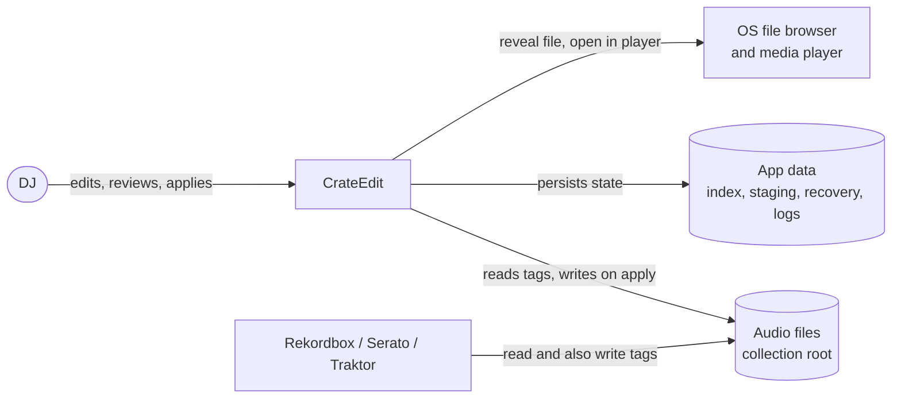
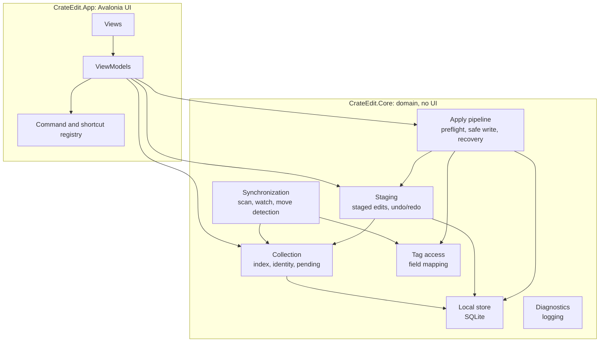
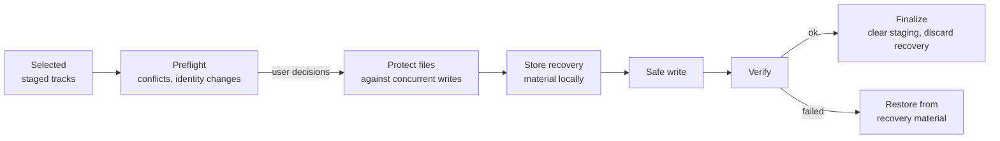

# CrateEdit: Architecture Overview
Draft | 9 October 2026 | Based on requirements v0.4

This document gives a high-level view of how CrateEdit is built and why. **What** the application must do is defined in [requirements.md](requirements.md), and **when** each part is built is in [roadmap.md](roadmap.md). The reasoning behind individual decisions is recorded in [Architecture Decision Records](adr/).

Each part is marked **Implemented**, **Planned** (decided but not built yet) or **Open** (depends on an unresolved OPEN item or spike).

## 1. Goals

CrateEdit lets a DJ inspect and fix the metadata of a large collection quickly, without ever putting the collection at risk.

The architecture is driven by these quality goals, in priority order:

| Priority | Quality goal | What it means here | Main requirements |
|---|---|---|---|
| 1 | **Data safety** | Audio files are never corrupted, unrelated metadata (cue points, beatgrids, GEOB frames) is never lost, and nothing is overwritten without the user's decision. | [REQ-052](requirements.md#req-052), [REQ-074](requirements.md#req-074), [REQ-088](requirements.md#req-088) to [REQ-093](requirements.md#req-093) |
| 2 | **Recoverability** | No user work is lost through crashes, power loss, disconnected drives or cancellation. | [REQ-053](requirements.md#req-053), [REQ-054](requirements.md#req-054), [REQ-083](requirements.md#req-083), [REQ-092](requirements.md#req-092), [REQ-121](requirements.md#req-121) |
| 3 | **Efficient keyboard workflow** | Editing thousands of tracks is fast, with no unnecessary dialogs. | [REQ-046](requirements.md#req-046) to [REQ-049](requirements.md#req-049), [REQ-058](requirements.md#req-058) |
| 4 | **Responsiveness at scale** | 20,000 tracks load in seconds and the UI never freezes. | [REQ-005](requirements.md#req-005), [REQ-015](requirements.md#req-015), [REQ-016](requirements.md#req-016), [REQ-077](requirements.md#req-077) |
| 5 | **Verifiability** | Every guardrail is checked automatically on every change. | [development.md](development.md) |

When goals conflict, the higher one wins. For example, an extra verification read after each write costs speed but is kept for data safety.

## 2. Constraints

- **Platforms:** Windows and macOS, as one codebase ([ADR-0001](adr/0001-avalonia-material-ui.md)).
- **Runtime:** .NET 10, C# ([ADR-0002](adr/0002-dotnet-solution-structure.md)).
- **Developer:** a single maintainer who knows .NET and WPF. Technology choices favor what is familiar and well supported over what is novel.
- **Storage:** collections can live on internal disks, USB drives or cloud-sync mounts (e.g. Google Drive for desktop). NAS is unsupported. File locking is enforced on Windows but only advisory on macOS.
- **Distribution:** unsigned releases on GitHub, GPL-3.0 ([ADR-0006](adr/0006-gpl-license.md)).
- **No network:** CrateEdit has no online features and never transmits data ([REQ-117](requirements.md#req-117)).

## 3. Context

The most important external actor is DJ software, because it **reads and writes the same files**. CrateEdit must never destroy what it wrote (cue points, beatgrids) and must notice when it changed something since the user staged an edit.

## 4. Solution strategy

These ideas shape the whole design:

1. **Stage everything, write only on apply.** Edits never touch audio files directly. They are stored as staged changes in local app data, and are only written when the user applies them. This makes editing fast, undoable and crash-proof, and it concentrates all write risk in one place ([ADR-0003](adr/0003-staging-first.md)).
2. **One guarded write path.** Exactly one component (the apply pipeline) may write audio files. Architecture tests enforce this, so no future feature can bypass the safety checks by accident.
3. **Local state is the source of truth for the app's own data.** The index, staged changes, pending flags and recovery material live in a local database, never in the collection. They survive a disconnected collection and are not visible to other software ([ADR-0004](adr/0004-sqlite-local-state.md)).
4. **Detect, don't assume.** External changes are detected by comparing what is on disk with what the user saw when staging. Conflicts are surfaced and resolved explicitly, never guessed.
5. **UI-independent core.** All domain logic lives in `CrateEdit.Core` with no UI dependency, so it is fully testable without a screen, and the UI is a thin MVVM layer on top ([ADR-0002](adr/0002-dotnet-solution-structure.md)).

## 5. Building blocks

| Block | Responsibility | Status |
|---|---|---|
| **Views / ViewModels** | Avalonia views with Material.Avalonia styling; view models hold UI state and call into Core. Views contain no logic beyond presentation. | Skeleton implemented |
| **Command and shortcut registry** | Every user action ("mark pending", "apply selected", ...) is defined once as a command; menus, buttons and keyboard shortcuts bind to it. Makes shortcuts configurable ([REQ-108](requirements.md#req-108)) and conflict-checked ([REQ-109](requirements.md#req-109)) in one place. Shortcuts are written platform-independently (`Primary` = Ctrl on Windows, Cmd on macOS). All shortcuts are currently global; per-context shortcuts depend on [OPEN-M](requirements.md#open-m). | Implemented (registry, key bindings, menu display); settings UI and persistence in Phase 11 |
| **Collection** | The indexed tracks, their identity, date added, pending status and availability (available, missing, unavailable). | Planned (Phases 2–4) |
| **Synchronization** | Initial scan, startup reconciliation, runtime file watching, move/rename detection, unavailable-root handling, activity history. | Planned (Phase 3), identity rules depend on [OPEN-F](requirements.md#open-f) |
| **Staging** | Staged edits per track and field, the values seen when staging (for conflict detection), staging timestamps, session undo/redo with grouped actions. | Planned (Phase 5) |
| **Apply pipeline** | The only component that writes audio files: preflight checks, protection against concurrent modification, recovery material, safe write, verification, retry, cancellation, reconciliation after a crash. | Safe write and crash reconciliation implemented (`SafeFileWriter`, `RecoveryReconciler`, [ADR-0010](adr/0010-safe-write-technique.md)); preflight, retry, cancellation and UI in Phases 6–8 |
| **Tag access** | ([format guide](formats/id3.md)) Maps the 9 logical fields to MP3 (ID3v2) and WAV tags, reads tags, and performs the low-level tag write on behalf of the apply pipeline. Own frame-level ID3v2 editor: only edited frames are rebuilt, all others are copied as raw bytes, and tags that are not fully understood are refused. | MP3 read/write implemented; WAV depends on [OPEN-D](requirements.md#open-d) ([ADR-0008](adr/0008-own-id3v2-frame-editor.md)) |
| **Local store** | SQLite database in the app data folder for the index, staging, pending flags, view state and recovery bookkeeping. | Planned (Phase 2) |
| **Diagnostics** | Local daily log files, 30-day retention, home-folder redaction, no transmission. | Implemented |

### Dependency rules
- `CrateEdit.App` depends on `CrateEdit.Core`, never the other way round.
- Only the **apply pipeline** may call the tag writer. Synchronization and the UI may only read tags.
- Nothing in the product references networking libraries ([REQ-117](requirements.md#req-117)).

These rules are enforced by architecture tests in `tests/CrateEdit.Tests/Architecture`, not just by convention. If a block needs a harder boundary later (e.g. to make the tag writer impossible to call from elsewhere), it moves into its own project.

## 6. Key concepts

### Track identity
A track is a **file instance** in the collection, not a piece of music: two copies of the same audio are two tracks ([REQ-023](requirements.md#req-023)). Identity must survive renames and moves ([OPEN-F](requirements.md#open-f)). The planned approach is to recognize a vanished file and a newly appeared file as the same track when size and audio content match, checking content only for candidates whose size matches, so it stays cheap.

### Track state
A track's availability and editing state are independent:

| Availability | Meaning |
|---|---|
| Available | File present and readable |
| Missing | Collection reachable, file gone ([REQ-024](requirements.md#req-024), [REQ-122](requirements.md#req-122)) |
| Unavailable | Collection root unreachable, e.g. unplugged or disconnected ([REQ-121](requirements.md#req-121)) |

Independently of that, a track may be **pending** (not yet processed by the user), have **staged changes**, have a **conflict**, or be in **unresolved recovery** (editing and playback blocked, [REQ-093](requirements.md#req-093)).

### Staged edits and effective values
A staged edit records, per field, the **new value** and the **on-disk value at the time of staging**. The second value is what makes conflict detection possible: if the file now holds something else, another program changed it. What the table, search and filters show when a staged value exists is still open ([OPEN-L](requirements.md#open-l)); the current proposal is the staged value, visibly marked.

### Apply pipeline

- **Recovery material** is stored in local app data, not next to the file, so it survives the collection disconnecting mid-write ([REQ-013](requirements.md#req-013)).
- **Safe write:** the file is either fully old or fully new, never half-written. The new file is written to a temporary file next to the original, verified, and swapped in with `File.Replace`. Tag-only recovery material in app data and a reconciliation step after crashes cover storage where the swap is not crash-atomic, such as FAT32 or Google Drive ([ADR-0010](adr/0010-safe-write-technique.md)).
- **Finalize** happens only when the run completes or the user keeps the result after cancelling. Until then, applied tracks can still be reverted ([REQ-083](requirements.md#req-083)).
- In the first release, preflight is a simple **stale-value check**: a track whose on-disk values changed since staging is skipped and reported. The full conflict resolution UI follows in Phase 7.

### Local data
Everything CrateEdit owns lives in the app data folder (`%LOCALAPPDATA%\CrateEdit` on Windows, `~/Library/Application Support/CrateEdit` on macOS):

| Data | Lifetime |
|---|---|
| Index, pending flags, date added | Permanent, until the collection is removed |
| Staged changes | Until applied or discarded; survives restarts and crashes |
| Recovery material | Only while a write is in flight or a cancellation is unresolved |
| View state, filters, shortcuts | Permanent preferences |
| Undo/redo history, activity history | Current session only |
| Diagnostic logs | 30 days |

## 7. Cross-cutting concepts

- **Logging:** Serilog to local daily files, home directory redacted, no network sinks. Implemented.
- **Errors:** expected failures are returned as `Result`s with typed errors that carry a stable code. Infrastructure exceptions are converted into such errors at boundaries, and programming errors are not caught. The UI translates error codes into localized messages ([ADR-0009](adr/0009-result-pattern-and-typed-errors.md)). In apply, failures in one track never stop independent tracks ([REQ-078](requirements.md#req-078)); transient failures are retried with a bound, and shared causes (e.g. a disconnected drive) are detected once instead of per track ([REQ-079](requirements.md#req-079)).
- **Threading:** scanning, synchronization and apply run in the background; the UI thread only renders and handles input. Long operations report progress and remain cancellable.
- **Localization:** all UI text comes from `.resx` resources in English and German, following the OS display language with English as fallback. Persisted data and logs are language-independent ([ADR-0007](adr/0007-localization-and-text-matching.md)). Implemented.
- **Text matching:** search ignores case and accents, sorting follows the user's regional conventions, and identity checks treat composed and decomposed Unicode as equal. All comparisons go through `TextMatching` in Core ([ADR-0007](adr/0007-localization-and-text-matching.md)). Implemented.
- **Testing:** unit, integration, architecture and headless end-to-end tests, tagged with requirement IDs ([development.md](development.md)).

## 8. Decisions

| ADR | Decision | Status |
|---|---|---|
| [0001](adr/0001-avalonia-material-ui.md) | Avalonia with Material.Avalonia for the UI | Accepted |
| [0002](adr/0002-dotnet-solution-structure.md) | .NET 10 with a UI-independent core project | Accepted |
| [0003](adr/0003-staging-first.md) | All edits are staged; files are written only on apply | Accepted |
| [0004](adr/0004-sqlite-local-state.md) | SQLite in app data for all local state | Proposed |
| [0005](adr/0005-taglibsharp.md) | TagLib# for tag reading and writing | Superseded by 0008 |
| [0006](adr/0006-gpl-license.md) | GPL-3.0 license | Accepted |
| [0007](adr/0007-localization-and-text-matching.md) | Localization with resource files; central text-matching rules | Accepted |
| [0008](adr/0008-own-id3v2-frame-editor.md) | Own frame-level ID3v2 editor instead of a tag library | Proposed |
| [0009](adr/0009-result-pattern-and-typed-errors.md) | Results with typed errors for expected failures | Proposed |
| [0010](adr/0010-safe-write-technique.md) | Safe write technique: temp file, recovery record, replace, verify | Proposed |

## 9. Risks

| Risk | Mitigation |
|---|---|
| A tag write damages proprietary DJ data (cues, beatgrids, GEOB) | Own frame-level editor that copies non-edited frames as raw bytes ([ADR-0008](adr/0008-own-id3v2-frame-editor.md)); byte-level preservation tests on synthetic Serato/Traktor frames and real files; still to be confirmed with files analyzed by Serato or Traktor |
| WAV tags written in a form DJ software does not read | Phase 1 spike and manual checks in each DJ application ([OPEN-D](requirements.md#open-d)) |
| Atomic replace behaves differently on cloud-sync mounts | Spike done: `File.Replace` works on Google Drive but is not crash-atomic there (nor on FAT32/exFAT); covered by local recovery material, verification and reconciliation ([ADR-0010](adr/0010-safe-write-technique.md)) |
| Other software (DJ applications, players) keeps files open and blocks writes | Treated as a transient failure with bounded retry and a clear report that names the program holding the file where Windows can tell (Restart Manager); CrateEdit's own player opens files permissively |
| macOS cannot enforce file locks | Expected; handled by the "protection unavailable" path ([REQ-073](requirements.md#req-073)) and the stale-value check |
| Avalonia grid performance or keyboard handling differs from WPF | Early table work in Phase 2 with 20,000 rows; headless end-to-end tests for keyboard flows |
