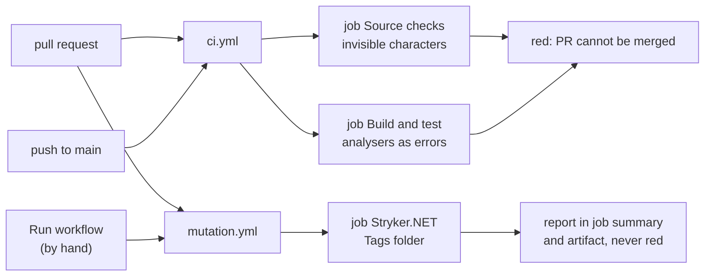

# CrateEdit: Development Process
Draft | 9 October 2026

## Branching
GitHub flow:
- `main` is always releasable and only changes through pull requests.
- Work happens on short-lived branches named `<type>/<short-description>`, e.g. `feat/tag-layer`, `fix/scan-progress`.
- PRs are squash-merged, so each PR becomes exactly one commit on `main`.
- No long-lived `develop` or release branches; releases are tags on `main`.

## Commits and changelog
- Commits follow [Conventional Commits](https://www.conventionalcommits.org/): `feat:`, `fix:`, `test:`, `docs:`, `refactor:`, `perf:`, `build:`, `ci:`, `chore:`. Breaking changes use `!` or a `BREAKING CHANGE:` footer.
- Because PRs are squash-merged, the **PR title** becomes the commit message on `main`; CI validates that it is a conventional commit.
- A scope may name the area, e.g. `feat(tags): write BPM and key to WAV`.
- [release-please](https://github.com/googleapis/release-please) reads the conventional commits on `main`, maintains a release PR with the next version and `CHANGELOG.md`, and creates the GitHub release and tag when that PR is merged.
- Versioning follows SemVer, starting at `0.x` until the requirements are complete. Before 1.0, `feat` bumps the minor version and `fix` the patch version. The version lives in `Directory.Build.props` and is updated only by release-please.
- The release PR is kept open and updated automatically; it is merged only when a release is intended (the first one at the end of Milestone 2).
- `feat`, `fix`, `perf` and `docs` appear in the changelog; `build`, `ci`, `test`, `refactor` and `chore` are hidden.

## Pull requests
- One PR per coherent, reviewable slice of a phase (typically several PRs per phase), not one PR per phase.
- Every PR states which requirement IDs it implements or touches.
- A PR merges only when CI is green on Windows and macOS and the owner has reviewed it.

## Error handling
Follow [ADR-0009](adr/0009-result-pattern-and-typed-errors.md):
- **Expected failures** return `Result` / `Result<T>` with a typed `Error`.
- **I/O exceptions** are converted into errors at boundaries.
- **Bugs** throw and are not caught.

Every new error code goes into `ErrorCodes` and needs an `Error_<code>` message in both resource files in the same PR; tests enforce this.

## User-facing text
- No hard-coded UI text: every string goes into `src/CrateEdit.App/Resources/Strings.resx` (English) **and** `Strings.de.resx` (German) in the same PR. Tests fail on missing translations and on literal text in XAML.
- Text comparisons (search, sorting, equality of names and paths) use `CrateEdit.Core.Text.TextMatching`, never ad-hoc `string.Equals` or `Contains`.

## Requirement and decision links
Every mention of a requirement (`REQ-NNN`), open decision (`OPEN-X`) or architecture decision record (`ADR-NNNN`) links to its definition:
- **In Markdown docs:** relative links, e.g. `[REQ-088](requirements.md#req-088)`. New requirements get an anchor (`<a id="req-131"></a>`) at the start of their definition.
- **In XML documentation comments** (`///` in `src/` and `tests/`): `<see href="...">` links to the file on GitHub, so they can be followed from the IDE.
- **In pull request descriptions:** absolute GitHub links, e.g. `[REQ-088](https://github.com/thomaswening/CrateEdit/blob/main/docs/requirements.md#req-088)`.

You don't need to write docs or code links by hand: run

```bash
dotnet run tools/RequirementLinks.cs -- --fix
```

and it adds missing anchors and links. CI runs the same tool with `--check` and fails on unlinked mentions, links to unknown requirements or decision records, and mentions of ones that do not exist.

The same check guards against broken links in general:
- relative links in Markdown must point to existing files;
- GitHub links to this repository in code comments must point to existing files;
- code comments refer to docs by GitHub link (e.g. `https://github.com/thomaswening/CrateEdit/blob/main/docs/formats/wav.md`), never by a bare path. `--fix` converts bare paths.

## Architecture documentation
- [architecture.md](architecture.md) is kept current: a PR that adds or changes a building block, dependency rule or key concept updates it in the same PR.
- Significant decisions (technology choices, data formats, safety mechanisms, anything hard to reverse) get an [Architecture Decision Record](adr/) in the PR that makes them. A changed decision gets a new ADR that supersedes the old one.

## Testing and guardrails
Each requirement that can be verified automatically gets at least one test tagged with its ID, e.g. `[Trait("Req", "REQ-088")]`. Tests are added in the same PR as the feature.

| Layer | What it covers | Examples |
|---|---|---|
| Unit | Core logic without I/O | staging model, undo grouping, retry classification, effective values |
| Integration | Real files and storage in temp directories | tag read/write round trips, byte-level preservation of audio and foreign frames (GEOB, cues), SQLite index, file watching, crash/fault injection during writes and recovery |
| Architecture | Structural rules on the code itself | only the apply component may reference the tag writer, so no other code path can write audio files ([REQ-052](requirements.md#req-052), [REQ-075](requirements.md#req-075)) |
| End-to-end | The real app UI driven headlessly via Avalonia.Headless | keyboard workflow, staging then apply, no autoplay on selection, prompts and their choices |

Key guardrails and how they are enforced:
- **No write outside apply** ([REQ-052](requirements.md#req-052), [REQ-075](requirements.md#req-075)): architecture test plus an integration test that edits, stages and undoes on real files and asserts their bytes are unchanged.
- **Preserve everything not edited** ([REQ-088](requirements.md#req-088)): byte-level comparison of all non-edited frames and the audio payload after every write test.
- **Never leave a corrupt file** ([REQ-088](requirements.md#req-088), [REQ-089](requirements.md#req-089), [REQ-092](requirements.md#req-092)): fault-injection tests that abort the write at each step and verify the file is either fully old or fully new and that recovery reconciles correctly.
- **No silent overwrite** ([REQ-074](requirements.md#req-074)): tests that change a file externally between staging and apply and assert it is skipped or flagged.
- **No automatic transmission** ([REQ-117](requirements.md#req-117)): architecture test that the app has no network-capable dependency in the diagnostics path.

### Writing tests
A test should be readable in one pass, top to bottom, by someone who does not know the code under test. A failing test is often the first thing a contributor reads about a feature.

- **Arrange, Act, Assert.** Every test has these three parts, marked with `// Arrange`, `// Act` and `// Assert` comments. A test with nothing to arrange starts at `// Act`. When the action is the assertion, as with `Assert.Throws`, the part is `// Act and assert`.
- **One behaviour, one act.** A test checks one thing the code does and calls the code under test once. A test that checks both reading and writing, or the success and the failure case, is split in two. Its name says which behaviour: `Clearing_a_field_removes_its_frame`.
- **No logic in the test body.** No loops, conditionals, ternaries or LINQ chains in tests. Anything that needs them goes into a helper with a name that says what it checks, such as `AssertOnlyEdited(before, after, "COMM")` or `after.Frame("TPE1")`. Helpers live in the fixture classes and test base classes, not in the tests.
- **One idea per line.** A line that builds a value, calls the code and compares the result does too much. Give intermediate values a name.
- **Name the values that matter.** A value the reader needs to understand gets a name, such as `const int TitleLength = 30;` or `var storeComment = Frames.Comment(...)`. A literal is fine when it is the point of the test, like `"Röyksopp"` in an encoding test.
- **Fixtures say what, not how.** Builders describe the input in domain terms (`Mp3Fixture.Build(4, Frames.DjSoftwareData())`, `WavFixture.WithInfo(...)`); the byte layout is hidden in the fixture.
- **Theory data reads as a table.** One case per `[InlineData]` line, with values a reader can check without running the test.

### Test fixtures
Real DJ-software-tagged files contain copyrighted audio and must not be committed. Fixtures in the repository are generated: short synthetic audio (silence or a tone) carrying tag frames copied from real files (Serato GEOB, Rekordbox/Traktor data), so the frames being protected are real while the audio is not. Original sample files stay outside the repository.

Tests that need real files (e.g. `RealFileTests`) read them from the folder in the `CRATEEDIT_SAMPLES` environment variable, always work on temporary copies, and are skipped when the variable is not set (as in CI). Run them locally before merging changes to tag reading or writing:
```bash
CRATEEDIT_SAMPLES=/path/to/sample/mp3s dotnet test -c Release --filter "FullyQualifiedName~RealFile"
```

Set `CRATEEDIT_WRITE_DIR` as well to run the safe-write tests on specific storage, e.g. a folder on a USB stick or on the Google Drive mount. The tests create and remove their own subfolder there.

### Requirements traceability
- CI produces a traceability report listing every requirement, the tests tagged with it, and a status: **Passing**, **Failing**, **Manual** or **Not covered**. It appears in each CI job's summary and in the `test-results-<os>` artifact.
- The report and a unit test both fail on tags that name a requirement that does not exist.
- To produce the report locally:
  ```bash
  dotnet build -c Release
  dotnet tests/CrateEdit.Tests/bin/Release/net10.0/CrateEdit.Tests.dll -xml TestResults/results.xml
  dotnet run tools/Traceability.cs -- --requirements docs/requirements.md --manual docs/manual-verification.md --results TestResults/results.xml --output TestResults/traceability.md
  ```
- Requirements that cannot be automated (e.g. "Rekordbox reads the written key", performance on the minimum configuration) are listed in `docs/manual-verification.md` with steps, and checked manually.
- **Phase exit check:** a phase is complete only when every requirement assigned to it in the roadmap is either covered by passing tests or listed and checked in the manual verification list, and the phase's open decisions are recorded in the requirements.

## Continuous integration
GitHub Actions on every PR and on `main`:
- build and all test layers on Windows and macOS,
- PR title check (conventional commit),
- traceability report in the job summary and as a build artifact,
- the coding-guideline checks in [Tools and checks](#tools-and-checks): analysers in the build, a search for invisible characters, and a mutation-testing report.

On `main`, the release-please workflow maintains the release PR. Building unsigned Windows and macOS packages and attaching them to the GitHub release is added before the first release (Milestone 2).

## Tools and checks
Three checks enforce rules of Thomas's coding guideline (the `coding-guideline` skill in [claude-config](https://github.com/thomaswening/claude-config), "Automated checks" in its C# reference). Rules without a check stay on the review checklist.



### Analysers in the build
Three .NET analysers are raised to warnings in [`.editorconfig`](../.editorconfig). `TreatWarningsAsErrors` in [`Directory.Build.props`](../Directory.Build.props) turns them into errors. They run in every `dotnet build`, so in both jobs of the "Build and test" matrix in [`ci.yml`](../.github/workflows/ci.yml), and in Visual Studio as you type. A hit fails the build and blocks the pull request.

| Analyser | Rule | Reported | Accepted |
|---|---|---|---|
| SYSLIB1045 | **A regular expression known at compile time is a `[GeneratedRegex]` method.** | `new Regex(@"^REQ-\d{3}$")`, `Regex.IsMatch(id, @"^REQ-\d{3}$")` | `[GeneratedRegex(@"^REQ-\d{3}$")] private static partial Regex RequirementId();` |
| CA1065 | **A property getter, operator or `Equals` does not throw an unexpected exception type.** | `_ => throw new ArgumentOutOfRangeException(nameof(Problem))` in a `Code` getter | `_ => throw new InvalidOperationException(...)` in a getter. CA1065 accepts `InvalidOperationException`, `NotSupportedException` and `KeyNotFoundException` there |
| CA1806 | **A returned result is used or discarded on purpose.** | `RmEndSession(session);` | `_ = RmEndSession(session);` with a comment why the result does not matter |

The message names the file, line and analyser, e.g. `FileAccessError.cs(44,14): error CA1065: get_Code creates an exception of type ArgumentOutOfRangeException`. Change the code as in the "Accepted" column. Where the rule does not fit, suppress that one member with `[SuppressMessage(..., Justification = "...")]` and say why. Never turn the analyser off for a file: that hides the next hit too. Current exemptions:

- `Result` and `Result<T>`: the implicit operators from `Error` throw on null, because turning a null error into a success would hide the bug.

Run locally with `dotnet build -c Release`.

### Invisible characters
**A C# source file holds no invisible character written literally.** A literal non-breaking space or byte order mark looks like nothing in a review. In PR 21 `Mp3Fixture` held a literal byte order mark that nobody could see. Write such a character as an escape, `""`.

The "Source checks" job in [`ci.yml`](../.github/workflows/ci.yml) runs on every pull request and push to `main`. It searches the tracked `*.cs` files with `git grep` and lists every line with a hit as `path:line:text`. Any hit fails the job and blocks the pull request.

| Case | Result |
|---|---|
| `" "` (escape) | accepted |
| a byte order mark at the start of a line, as an editor writes at the start of a file | accepted |
| a literal byte order mark anywhere else | reported |
| a literal non-breaking space (U+00A0), soft hyphen (U+00AD), zero-width space, non-joiner or joiner (U+200B to U+200D), or word joiner (U+2060) | reported |
| a confusable letter such as a Cyrillic `а` | not searched for: code may hold non-Latin text |

When it fails, open the listed line, find the character (an editor that shows invisible characters helps) and replace it with its `\uXXXX` escape. Run it locally in Git Bash:
```bash
git grep -nP '(?<!^)\x{FEFF}|[\x{00A0}\x{00AD}\x{200B}-\x{200D}\x{2060}]' -- '*.cs'
```
No output means no hit.

### Mutation testing
**A test of the tag and write code fails when that code is broken.** In PR 21 the iTunes comment tests passed without testing anything. Only breaking the code showed it. [Stryker.NET](https://stryker-mutator.io/docs/stryker-net/introduction/) makes many such small breaks (mutants), such as `<` to `<=` or a removed statement, and runs the tests against each. A mutant that no test fails on survives and points to a test to doubt.

[`mutation.yml`](../.github/workflows/mutation.yml) runs on every pull request and by hand (Actions, "Mutation testing", "Run workflow"). It mutates `src/CrateEdit.Core/Tags/**`, which holds the tag readers and writers and the safe write in `Tags/Writing`, as set in [`tests/CrateEdit.Tests/stryker-config.json`](../tests/CrateEdit.Tests/stryker-config.json). The config picks the Microsoft Testing Platform runner (`mtp`). The default VSTest runner does not see the mutants with xunit v3: it scored 2 % on 26 October 2026, where `mtp` scores 80 % on the same file. It takes several minutes. **It never blocks a pull request**: the job does not fail on a low score and is marked `continue-on-error`. The score and a table per file appear in the job summary. The HTML report, with each surviving mutant shown in the code, is the `mutation-report` artifact.

| Mutant status | Means |
|---|---|
| Killed | a test failed on it: good |
| Survived | every test passed: look at the tests for that line |
| No coverage | no test runs that line at all |
| Timeout | the mutant made a test hang. Counts as killed |
| Compile error, ignored | not counted in the score |

In a review, read the surviving mutants in the lines the pull request changed. Either a test should fail on them, or the mutant does not change behaviour (an equivalent mutant, such as a changed log message). The score is a pointer, not a target.

Run locally (the version is pinned in [`dotnet-tools.json`](../dotnet-tools.json)):
```bash
dotnet tool restore
cd tests/CrateEdit.Tests
dotnet stryker
```
The report lands in `tests/CrateEdit.Tests/StrykerOutput/<date>/reports/mutation-report.html`, which Git ignores.

## Releases and distribution
- Releases are published on GitHub Releases, unsigned. Windows SmartScreen and macOS Gatekeeper will warn on first launch; the release notes explain how to open the app anyway.
- The README and every release state that the software is provided as is and used at your own risk.
- The first release is planned at the end of Milestone 2 (see [roadmap.md](roadmap.md)).
