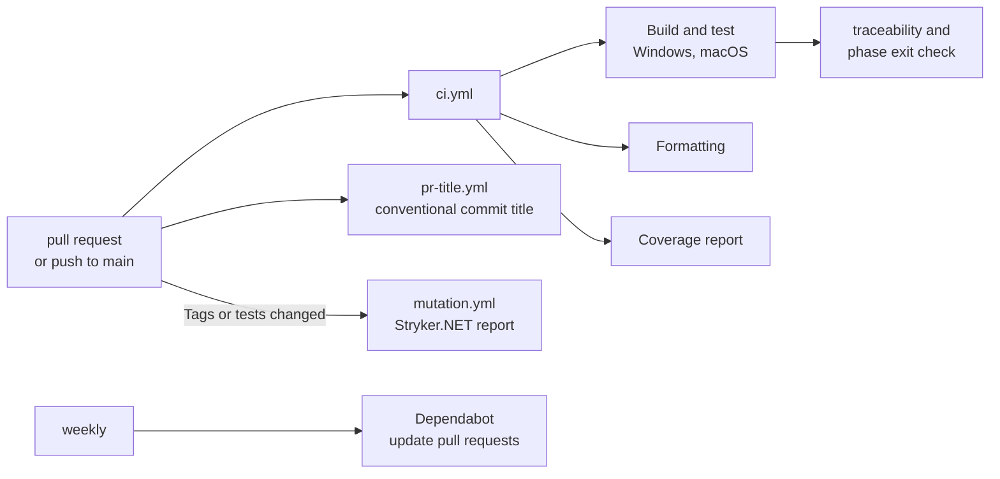

# CrateEdit: Development Process
Draft | 9 October 2026

## Branching
GitHub flow:
- `main` is always releasable and only changes through pull requests.
- Work happens on short-lived branches named `<type>/<short-description>`, e.g. `feat/tag-layer`, `fix/scan-progress`.
- PRs are squash-merged, so each PR becomes exactly one commit on `main`.
- No long-lived `develop` or release branches; releases are tags on `main`.

## Commits and changelog
- Commits follow [Conventional Commits](https://www.conventionalcommits.org/): `feat:`, `fix:`, `test:`, `docs:`, `refactor:`, `perf:`, `build:`, `ci:`, `chore:`. Breaking changes use `!` or a `BREAKING CHANGE:` footer.
- Because PRs are squash-merged, the **PR title** becomes the commit message on `main`; CI validates that it is a conventional commit.
- A scope may name the area, e.g. `feat(tags): write BPM and key to WAV`.
- [release-please](https://github.com/googleapis/release-please) reads the conventional commits on `main`, maintains a release PR with the next version and `CHANGELOG.md`, and creates the GitHub release and tag when that PR is merged.
- Versioning follows SemVer, starting at `0.x` until the requirements are complete. Before 1.0, `feat` bumps the minor version and `fix` the patch version. The version lives in `Directory.Build.props` and is updated only by release-please.
- The release PR is kept open and updated automatically; it is merged only when a release is intended (the first one at the end of Milestone 2).
- `feat`, `fix`, `perf` and `docs` appear in the changelog; `build`, `ci`, `test`, `refactor` and `chore` are hidden.

## Pull requests
- One PR per coherent, reviewable slice of a phase (typically several PRs per phase), not one PR per phase.
- Every PR states which requirement IDs it implements or touches.
- A PR merges only when CI is green on Windows and macOS and the owner has reviewed it.

## Error handling
Follow [ADR-0009](adr/0009-result-pattern-and-typed-errors.md):
- **Expected failures** return `Result` / `Result<T>` with a typed `Error`.
- **I/O exceptions** are converted into errors at boundaries.
- **Bugs** throw and are not caught.

Every new error code goes into `ErrorCodes` and needs an `Error_<code>` message in both resource files in the same PR; tests enforce this.

## User-facing text
- No hard-coded UI text: every string goes into `src/CrateEdit.App/Resources/Strings.resx` (English) **and** `Strings.de.resx` (German) in the same PR. Tests fail on missing translations and on literal text in XAML.
- Text comparisons (search, sorting, equality of names and paths) use `CrateEdit.Core.Text.TextMatching`, never ad-hoc `string.Equals` or `Contains`.

## Requirement and decision links
Every mention of a requirement (`REQ-NNN`), open decision (`OPEN-X`) or architecture decision record (`ADR-NNNN`) links to its definition:
- **In Markdown docs:** relative links, e.g. `[REQ-088](requirements.md#req-088)`. New requirements get an anchor (`<a id="req-131"></a>`) at the start of their definition.
- **In XML documentation comments** (`///` in `src/` and `tests/`): `<see href="...">` links to the file on GitHub, so they can be followed from the IDE.
- **In pull request descriptions:** absolute GitHub links, e.g. `[REQ-088](https://github.com/thomaswening/CrateEdit/blob/main/docs/requirements.md#req-088)`.

You don't need to write docs or code links by hand: run

```bash
dotnet run tools/RequirementLinks.cs -- --fix
```

and it adds missing anchors and links. CI runs the same tool with `--check` and fails on unlinked mentions, links to unknown requirements or decision records, and mentions of ones that do not exist.

The same check guards against broken links in general:
- relative links in Markdown must point to existing files;
- GitHub links to this repository in code comments must point to existing files;
- code comments refer to docs by GitHub link (e.g. `https://github.com/thomaswening/CrateEdit/blob/main/docs/formats/wav.md`), never by a bare path. `--fix` converts bare paths.

## Architecture documentation
- [architecture.md](architecture.md) is kept current: a PR that adds or changes a building block, dependency rule or key concept updates it in the same PR.
- Significant decisions (technology choices, data formats, safety mechanisms, anything hard to reverse) get an [Architecture Decision Record](adr/) in the PR that makes them. A changed decision gets a new ADR that supersedes the old one.

## Testing and guardrails
Each requirement that can be verified automatically gets at least one test tagged with its ID, e.g. `[Trait("Req", "REQ-088")]`. Tests are added in the same PR as the feature.

| Layer | What it covers | Examples |
|---|---|---|
| Unit | Core logic without I/O | staging model, undo grouping, retry classification, effective values |
| Integration | Real files and storage in temp directories | tag read/write round trips, byte-level preservation of audio and foreign frames (GEOB, cues), SQLite index, file watching, crash/fault injection during writes and recovery |
| Architecture | Structural rules on the code itself | only the apply component may reference the tag writer, so no other code path can write audio files ([REQ-052](requirements.md#req-052), [REQ-075](requirements.md#req-075)) |
| End-to-end | The real app UI driven headlessly via Avalonia.Headless | keyboard workflow, staging then apply, no autoplay on selection, prompts and their choices |

Key guardrails and how they are enforced:
- **No write outside apply** ([REQ-052](requirements.md#req-052), [REQ-075](requirements.md#req-075)): architecture test plus an integration test that edits, stages and undoes on real files and asserts their bytes are unchanged.
- **Preserve everything not edited** ([REQ-088](requirements.md#req-088)): byte-level comparison of all non-edited frames and the audio payload after every write test.
- **Never leave a corrupt file** ([REQ-088](requirements.md#req-088), [REQ-089](requirements.md#req-089), [REQ-092](requirements.md#req-092)): fault-injection tests that abort the write at each step and verify the file is either fully old or fully new and that recovery reconciles correctly.
- **No silent overwrite** ([REQ-074](requirements.md#req-074)): tests that change a file externally between staging and apply and assert it is skipped or flagged.
- **No automatic transmission** ([REQ-117](requirements.md#req-117)): architecture test that the app has no network-capable dependency in the diagnostics path.

### Writing tests
A test should be readable in one pass, top to bottom, by someone who does not know the code under test. A failing test is often the first thing a contributor reads about a feature.

- **Arrange, Act, Assert.** Every test has these three parts, marked with `// Arrange`, `// Act` and `// Assert` comments. A test with nothing to arrange starts at `// Act`. When the action is the assertion, as with `Assert.Throws`, the part is `// Act and assert`.
- **One behaviour, one act.** A test checks one thing the code does and calls the code under test once. A test that checks both reading and writing, or the success and the failure case, is split in two. Its name says which behaviour: `Clearing_a_field_removes_its_frame`.
- **No logic in the test body.** No loops, conditionals, ternaries or LINQ chains in tests. Anything that needs them goes into a helper with a name that says what it checks, such as `AssertOnlyEdited(before, after, "COMM")` or `after.Frame("TPE1")`. Helpers live in the fixture classes and test base classes, not in the tests.
- **One idea per line.** A line that builds a value, calls the code and compares the result does too much. Give intermediate values a name.
- **Name the values that matter.** A value the reader needs to understand gets a name, such as `const int TitleLength = 30;` or `var storeComment = Frames.Comment(...)`. A literal is fine when it is the point of the test, like `"Röyksopp"` in an encoding test.
- **Fixtures say what, not how.** Builders describe the input in domain terms (`Mp3Fixture.Build(4, Frames.DjSoftwareData())`, `WavFixture.WithInfo(...)`); the byte layout is hidden in the fixture.
- **Theory data reads as a table.** One case per `[InlineData]` line, with values a reader can check without running the test.

### Test fixtures
Real DJ-software-tagged files contain copyrighted audio and must not be committed. Fixtures in the repository are generated: short synthetic audio (silence or a tone) carrying tag frames copied from real files (Serato GEOB, Rekordbox/Traktor data), so the frames being protected are real while the audio is not. Original sample files stay outside the repository.

Tests that need real files (e.g. `RealFileTests`) read them from the folder in the `CRATEEDIT_SAMPLES` environment variable, always work on temporary copies, and are skipped when the variable is not set (as in CI). Run them locally before merging changes to tag reading or writing:
```bash
CRATEEDIT_SAMPLES=/path/to/sample/mp3s dotnet test -c Release --filter "FullyQualifiedName~RealFile"
```

Set `CRATEEDIT_WRITE_DIR` as well to run the safe-write tests on specific storage, e.g. a folder on a USB stick or on the Google Drive mount. The tests create and remove their own subfolder there.

### Requirements traceability
- CI produces a traceability report listing every requirement, the tests tagged with it, and a status such as **Passing**, **Manual** or **Not covered**. It appears in each CI job's summary and in the `test-results-<os>` artifact.
- The report and a unit test both fail on tags that name a requirement that does not exist.
- Requirements that cannot be automated (e.g. "Rekordbox reads the written key", performance on the minimum configuration) are listed in `docs/manual-verification.md` with steps, and checked manually.
- **Phase exit check:** a phase is complete only when every requirement assigned to it in the roadmap is either covered by passing tests or listed and checked in the manual verification list, and the open decisions it resolves or needs are resolved. CI checks this for every phase up to the last completed one.

[Traceability report and phase exit check](tools/traceability.md) has the rules, what to do when the check fails and how to run it locally.

## Continuous integration
GitHub Actions run on every pull request and on every push to `main`. Jobs marked "blocks" must be green before a pull request is merged. Informational jobs never turn red.



| Workflow, job | Checks | Blocks |
|---|---|---|
| `ci.yml`, Build and test | build with analysers, requirement links, all tests, [traceability and phase exit check](tools/traceability.md) | yes |
| `ci.yml`, Formatting | [code matches `.editorconfig`](#analysers-and-formatting) | yes |
| `ci.yml`, Coverage report | [which lines the tests run](#coverage-report) | no |
| `mutation.yml` | [which changes to the tag code no test notices](#mutation-report) | no |
| `pr-title.yml` | the pull request title is a conventional commit | yes |

On `main`, the release-please workflow maintains the release PR. Building unsigned Windows and macOS packages and attaching them to the GitHub release is added before the first release (Milestone 2).

### Analysers and formatting
**Rule 1: the build has no analyser finding.** `Directory.Build.props` turns on the recommended .NET code analysers (`AnalysisLevel` `latest-recommended`) and the code style of `.editorconfig` (`EnforceCodeStyleInBuild`). With `TreatWarningsAsErrors`, every finding fails the build, locally as in CI. The analysers catch bugs a reviewer easily misses, such as an ignored return value or a culture-dependent `int.Parse`. The coding guideline raises three rules to warnings: `SYSLIB1045` (a constant pattern is a `[GeneratedRegex]` method), `CA1065` (no exceptions from property getters) and `CA1806` (no ignored results). The tools in `tools/` get the same analysers when `dotnet run` builds them.

| Case | Reported | Accepted |
|---|---|---|
| Ignored result of a native call | `RmEndSession(session);` (CA1806) | `_ = RmEndSession(session);` with a comment why |
| Culture-dependent parsing | `int.Parse(text)` (CA1305) | `int.Parse(text, CultureInfo.InvariantCulture)` |
| Regular expression built at run time from a constant | `new Regex(@"^REQ-\d{3}$")` (SYSLIB1045) | a `[GeneratedRegex]` method |
| Test name with underscores | — | `Clearing_a_field_removes_its_frame` (CA1707 is off in `tests/`) |
| A type named `Error` | — | `Error` (CA1716 is off: CrateEdit is not a library for Visual Basic) |

When the build fails, the message names the file, line and rule, e.g. `Result.cs(23,73): error CA1065: …`. The rule ID links Microsoft's description with the usual fix. Fix the code where you can. Where a finding is wrong for one place, suppress it there with `[SuppressMessage("Category", "CAnnnn", Justification = "…")]` and say why. A rule that is wrong for the whole project is switched off in `.editorconfig`, in the "Analysers" section, with its reason on the line above. Such a change is reviewed like code.

**Rule 2: the code matches `.editorconfig`.** The Formatting job runs `dotnet format --verify-no-changes`, which fails on any difference in whitespace, `using` order or code style. A reviewer then never has to comment on layout.

| Case | Reported | Accepted |
|---|---|---|
| Missing newline at the end of a file | `error FINALNEWLINE: Fix final newline` | the file ends with a newline |
| `using` directives not sorted | `error IMPORTS: Fix imports ordering.` | `System` first, then alphabetically. The code puts no blank line between groups, though the check allows one. |

To fix it, run `dotnet format CrateEdit.slnx` and commit the result. Check before pushing with:

```bash
dotnet format CrateEdit.slnx --verify-no-changes
```

The check covers the solution's projects, not the scripts in `tools/`.

### Coverage report
The Coverage job runs all tests on Linux under [dotnet-coverage](https://learn.microsoft.com/dotnet/core/additional-tools/dotnet-coverage) and turns the result into a report with [ReportGenerator](https://reportgenerator.io). Line and branch coverage of `CrateEdit.Core` and `CrateEdit.App` appear in the job summary. The full HTML report, with every line marked as run or not, is in the `coverage-report` artifact. It is informational: a coverage number says which code no test runs, not whether the tests check anything. On 26 October 2026, line coverage was 90.7 % and branch coverage 86.3 %.

```bash
dotnet tool restore
dotnet build -c Release
dotnet dotnet-coverage collect -f cobertura -o TestResults/coverage.cobertura.xml "dotnet tests/CrateEdit.Tests/bin/Release/net10.0/CrateEdit.Tests.dll"
dotnet reportgenerator -reports:TestResults/coverage.cobertura.xml -targetdir:TestResults/coverage "-reporttypes:Html" "-assemblyfilters:+CrateEdit.Core;+CrateEdit.App"
```

### Mutation report
Mutation testing checks whether the tests would notice a bug. [Stryker.NET](https://stryker-mutator.io/docs/stryker-net/introduction/) makes one small change at a time to the code under test, a **mutant**: for example `<` becomes `<=`, or a condition becomes `true`. It runs the tests against each mutant. A mutant that makes a test fail is **killed**. One that every test survives shows code whose behaviour no test checks. In [#21](https://github.com/thomaswening/CrateEdit/pull/21) such a check found the iTunes comment tests passing without testing anything.

The `mutation.yml` workflow mutates `src/CrateEdit.Core/Tags`, where a wrong test costs most, on every pull request that changes that code or the tests, on `main`, and by hand ("Run workflow"). Settings are in `tests/CrateEdit.Tests/stryker-config.json`. They select Stryker's Microsoft Testing Platform runner (`"test-runner": "mtp"`, a preview in Stryker 5.0). The default VSTest runner does not work with these xUnit v3 tests. On 26 October 2026 it killed 11 of 744 mutants (1.5 %). On `Id3v1Tag.cs` alone, the MTP runner killed 25 where VSTest killed 1. The job summary shows the mutation score per file, the share of mutants killed. The `mutation-report` artifact holds an HTML report that shows each surviving mutant in its line. It is informational. In a review, look at the survivors in the code the pull request changes: each is either a missing assertion or code that does nothing observable.

It takes several minutes. To run it locally:

```bash
dotnet tool restore
cd tests/CrateEdit.Tests
dotnet dotnet-stryker
```

### Dependency updates
Dependabot (`.github/dependabot.yml`) opens update pull requests once a week: NuGet packages in `Directory.Packages.props`, the .NET tools in `dotnet-tools.json`, and the actions in `.github/workflows`. Minor and patch updates come together in one pull request per ecosystem. Each major update gets its own. Titles are conventional commits (`build(deps): …`, `ci(deps): …`), so they pass the title check and stay out of the changelog. Review them like any pull request: CI must be green, and a major update needs a look at its release notes.

## Releases and distribution
- Releases are published on GitHub Releases, unsigned. Windows SmartScreen and macOS Gatekeeper will warn on first launch; the release notes explain how to open the app anyway.
- The README and every release state that the software is provided as is and used at your own risk.
- The first release is planned at the end of Milestone 2 (see [roadmap.md](roadmap.md)).
