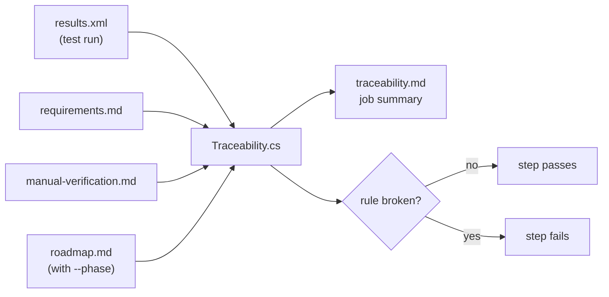

# Traceability report and phase exit check

`tools/Traceability.cs` lists every requirement with the tests tagged with it and their results. With `--phase N` it also checks that phases 0 to N of the [roadmap](../roadmap.md) are complete, so a finished phase cannot silently lose a test or a manual check.

## When it runs and what a failure blocks

It runs in the CI workflow ([`ci.yml`](../../.github/workflows/ci.yml)), job "Build and test", step "Requirements traceability and phase exit check", on Windows and on macOS, for every pull request and every push to `main`. The step passes `--phase` the value of `LAST_COMPLETED_PHASE` at the top of `ci.yml`. A failure turns the job red, so the pull request is not merged. The report appears in the job summary and in the `test-results-<os>` artifact as `traceability.md`.



## How a requirement gets its status

Each requirement gets one status from the tests tagged `[Trait("Req", "REQ-nnn")]` and from the manual list. Skipped tests are ignored. The real-file tests are skipped in CI, for one. With several result files, one per operating system, a test must pass in all of them.

| Status | When | Example |
|---|---|---|
| Passing | All tagged tests ran and passed | [REQ-130](../requirements.md#req-130) |
| Failing | At least one tagged test failed | — |
| Incomplete | Tagged tests ran, none failed, but not all passed (e.g. not run) | — |
| Manual | No tagged test ran. The manual list has a row whose "Last verified" cell starts with a date. | [REQ-011](../requirements.md#req-011): `13 Oct 2026: passed. …` |
| Manual, not verified yet | No tagged test ran. The manual list has a row, but its "Last verified" cell does not start with a date. | [REQ-125](../requirements.md#req-125): `not yet` |
| Not covered | No tagged test ran and the manual list has no row | most requirements of later phases |

## The rules

### Rule 1: every requirement tag names a requirement that exists

**Why:** a typo such as `REQ-0088` would make a test count for nothing, and the requirement it meant would look less covered than it is.

**How it decides:** it collects every `Req` trait from the test results and looks each one up among the `**REQ-nnn — Title (LEVEL).**` definitions in `requirements.md`. It reports `**Error:** tests reference unknown requirements: REQ-0088`. A unit test, `RequirementTagTests`, checks the same in the test run itself.

| Case | Reported | Accepted |
|---|---|---|
| Tag of a defined requirement | — | `[Trait("Req", "REQ-088")]` |
| Typo or removed requirement | `[Trait("Req", "REQ-0088")]` | — |

### Rule 2: no requirement has a failing test

**Why:** a failing test tagged with a requirement means that requirement is broken. The test step already fails then, but the report says which requirement is affected.

**How it decides:** a requirement with the status Failing fails the step. The report lists it with its tests.

### Rule 3: every requirement of a completed phase is passing or verified by hand

Checked only with `--phase N`, for phases 0 to N.

**Why:** a phase is complete only when each of its requirements is covered ([development.md](../development.md#requirements-traceability)). Without the check, a later change could remove a test or a manual row unnoticed.

**How it decides:** it reads each `### Phase N:` section of `roadmap.md` up to the next heading. On its `- Requirements:` line it takes every requirement, links or not. A range such as `REQ-123 to REQ-129` stands for every requirement defined in between. Each must have the status Passing or Manual. Every other status is reported as a row of the table under "Phase exit check", e.g. `| 1 | REQ-091 Bounded temporary storage | Not covered |`.

| Case | Reported | Accepted |
|---|---|---|
| Tagged tests all pass | — | [REQ-130](../requirements.md#req-130) in Phase 1 |
| Manual check done | — | [REQ-092](../requirements.md#req-092): `13 Oct 2026, feat/safe-file-writer: …` |
| Manual check not done yet | [REQ-125](../requirements.md#req-125) in Phase 0 with `not yet` | the same row once it starts with a date |
| No test and no manual row | [REQ-091](../requirements.md#req-091) in Phase 1 before its test | — |
| A range with a gap | — | `REQ-017 to REQ-023` covers only the requirements defined in between |
| Roadmap names a requirement that is not defined | `REQ-999 \| not defined in requirements.md` | — |
| Requirement of a later phase | — | not checked until `LAST_COMPLETED_PHASE` reaches that phase |

### Rule 4: every open decision of a completed phase is resolved

Checked only with `--phase N`, for phases 0 to N.

**Why:** a phase depends on the decisions it resolves (`- Resolves:`) and the ones it needs (`- Needs:`). If one is still open, the phase was built on a guess.

**How it decides:** it takes every `OPEN-X` on those lines. A decision counts as resolved when its definition in `requirements.md` reads `**OPEN-X — Title.** **Resolved** …`. It reports `| 2 | OPEN-N | not resolved |`.

| Case | Reported | Accepted |
|---|---|---|
| Resolved decision | — | [OPEN-C](../requirements.md#open-c) in Phase 1: `**Resolved** by ADR-0010 …` |
| Open decision of a completed phase | [OPEN-N](../requirements.md#open-n) once Phase 2 is marked complete | — |

## What to do when it fails

Open the job summary of the failing job. The table under "Phase exit check" names the phase, the requirement or decision, and the problem.

- **Not covered** or **Incomplete:** add or fix a test tagged with the requirement. If it cannot be automated, add a row to [manual-verification.md](../manual-verification.md).
- **Manual, not verified yet:** do the manual check and write its date and result into the "Last verified" cell, e.g. `26 Oct 2026: passed`.
- **Failing:** fix the code or the test. The test step shows the failure.
- **not defined in requirements.md:** correct the ID in the roadmap.
- **not resolved:** resolve the decision in `requirements.md`, or move the requirement that needs it to a later phase in the roadmap.

There are no exemptions. A requirement that cannot be finished in its phase moves to a later phase in the roadmap, so the move is visible in review. [REQ-125](../requirements.md#req-125) moved from Phase 0 to Phase 2 that way on 26 October 2026.

When a pull request completes a phase, it raises `LAST_COMPLETED_PHASE` in `ci.yml` in the same pull request.

## Run it locally

```bash
dotnet build -c Release
dotnet tests/CrateEdit.Tests/bin/Release/net10.0/CrateEdit.Tests.dll -xml TestResults/results.xml
dotnet run tools/Traceability.cs -- --requirements docs/requirements.md --manual docs/manual-verification.md --results TestResults/results.xml --roadmap docs/roadmap.md --phase 1 --output TestResults/traceability.md
```

The exit code is 0 when all rules hold and 1 otherwise. The tool has no tests of its own. CI runs it on the real documents with every pull request.
